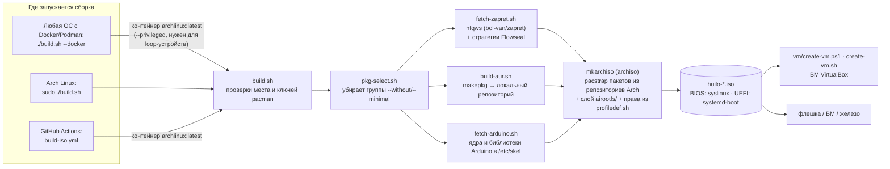
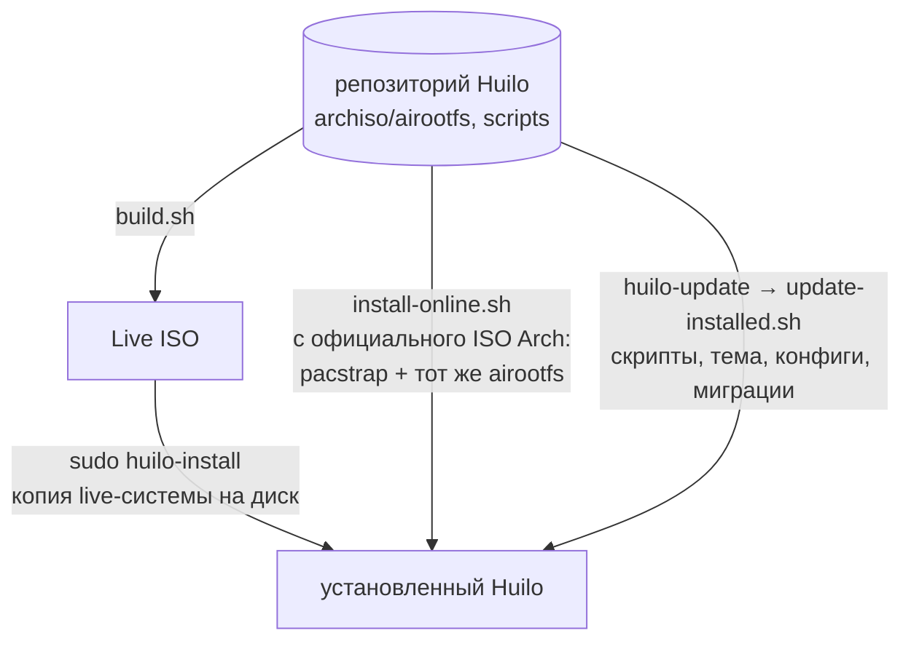
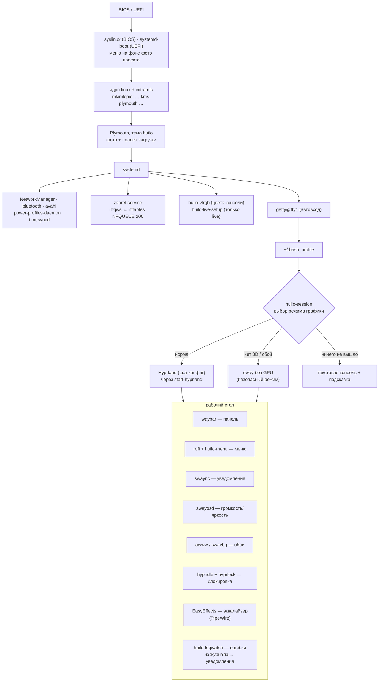
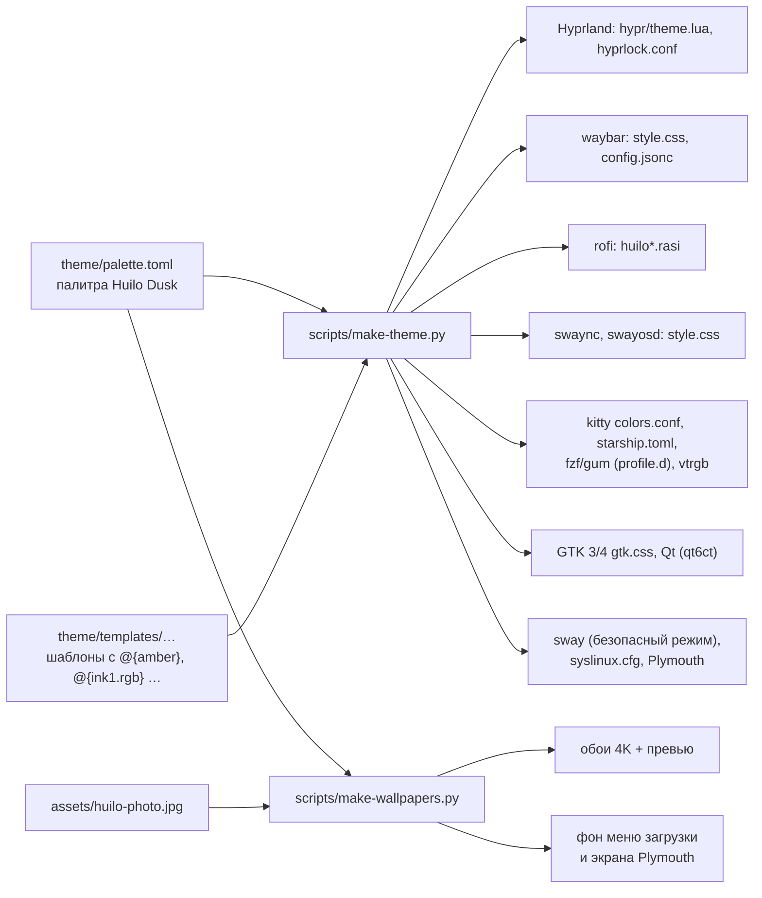
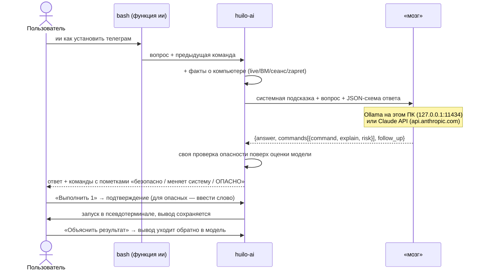

# Как устроен Huilo

Huilo — это не отдельный дистрибутив с собственными пакетами, а **сборка Arch Linux**: те же репозитории
`core/extra/multilib`, тот же `pacman`, плюс слой своих файлов (скрипты `huilo-*`, конфиги, тема, обои, службы).
Всё «своё» лежит в этом репозитории как обычные текстовые файлы и попадает в систему тремя путями: в ISO-образ,
при установке с официального ISO Arch и при обновлении уже установленной системы.

* [1. Что из чего собирается (сборка ISO)](#1-что-из-чего-собирается-сборка-iso)
* [2. Три пути в систему](#2-три-пути-в-систему)
* [3. Что работает в запущенной системе](#3-что-работает-в-запущенной-системе)
* [4. Внешний вид: одна палитра → все конфиги](#4-внешний-вид-одна-палитра--все-конфиги)
* [5. ИИ-помощник](#5-ии-помощник)
* [6. Проверки (CI)](#6-проверки-ci)
* [7. Технологии](#7-технологии)
* [8. Зависимости скриптов Huilo](#8-зависимости-скриптов-huilo)
* [9. Карта репозитория](#9-карта-репозитория)

---

## 1. Что из чего собирается (сборка ISO)



Что важно знать:

* **Docker используется только для сборки** на компьютере, где нет Arch Linux: `build.sh --docker` запускает самого себя
  внутри контейнера `archlinux:latest`. Сама система Huilo контейнеры не использует; Docker/Podman в ней есть только как
  инструмент администратора (необязательная группа `virt`).
* Пакеты **не перепаковываются**: в образ ставятся стандартные пакеты Arch по списку `archiso/packages.x86_64`
  (разбит на группы `# ---------- [тег] ----------`), плюс AUR-пакеты из `archiso/packages.aur`, собранные из PKGBUILD.
* Всё своё — каталог `archiso/airootfs/`: он накладывается поверх установленных пакетов «как есть».
  `mkarchiso` копирует его **без прав доступа**, поэтому каждый исполняемый файл обязан быть в `file_permissions`
  в `archiso/profiledef.sh` (это проверяет `scripts/check-permissions.sh`).
* Часть файлов в `airootfs/` **генерируется** и хранится в git уже готовыми: тема (`scripts/make-theme.py`),
  обои и картинки загрузки (`scripts/make-wallpapers.py`). Сборка ISO их не пересоздаёт — она просто копирует.

## 2. Три пути в систему



| Путь | Команда | Что делает |
|---|---|---|
| Live ISO → диск | `sudo huilo-install` | разметка, перенос live-системы, загрузчик (UEFI: systemd-boot, BIOS: GRUB), пользователь |
| Без сборки ISO | `scripts/install-online.sh` с официального ISO Arch | ставит те же пакеты и накладывает тот же `airootfs/` |
| Обновление | `huilo-update` (= `update-installed.sh`) | новые скрипты и конфиги без переустановки; старые конфиги → `*.bak-<дата>`; переименования ASOS → Huilo |

## 3. Что работает в запущенной системе



* **Звук**: PipeWire + WirePlumber, поверх — EasyEffects с LV2-плагинами LSP (эквалайзер `huilo-eq`).
* **Обход блокировок**: `zapret.service` запускает `nfqws`, правила nftables отправляют в него нужный трафик
  (очередь NFQUEUE 200); стратегии и списки — из Flowseal, управление — `huilo-zapret`.
* **Безопасный режим**: если Hyprland не может стартовать (нет 3D в ВМ, сломанный драйвер), `huilo-session` сам
  переключится на sway с программной отрисовкой (pixman) — те же клавиши, та же панель и тема.

## 4. Внешний вид: одна палитра → все конфиги



Палитра — одна на всё: тёмные «чернильные» фоны (`ink0…ink4`), тёплый текст (`snow`), янтарный акцент (`amber`)
и вспомогательные цвета. Поменяли цвет в `palette.toml` → `python3 scripts/make-theme.py` → изменились панель, меню,
уведомления, терминал, экран блокировки, GTK/Qt и даже цвета текстовой консоли. Подробно — в [MAINTAINING.md](MAINTAINING.md).

Компоненты интерфейса:

| Что | Чем сделано | Где настраивается |
|---|---|---|
| Окна, анимации, размытие | Hyprland 0.57 (Lua) | `~/.config/hypr/hyprland.lua`, свои правки — `user.lua` |
| Панель | Waybar (GTK3) | `~/.config/waybar/` |
| Меню: приложения, Huilo, питание, буфер, эмодзи, Wi-Fi, обои | rofi 2 + `huilo-menu` | `/usr/share/rofi/themes/huilo*.rasi`, `~/.config/rofi/config.rasi` |
| Уведомления и центр управления | swaync (GTK4) | `~/.config/swaync/` |
| Индикатор громкости/яркости | swayosd | `~/.config/swayosd/` |
| Экран блокировки | hyprlock | `~/.config/hypr/hyprlock.conf` |
| Приложения GTK / Qt | adw-gtk3, libadwaita, qt6ct + Papirus, Inter, курсор Capitaine | `gtk-3.0/`, `gtk-4.0/`, `qt6ct/`, `huilo-theme apply` |
| Терминал | kitty + starship + fastfetch | `~/.config/kitty/`, `starship.toml`, `fastfetch/` |
| Текстовые меню скриптов | dialog (`/usr/share/huilo/theme/dialogrc`), gum | `/etc/profile.d/huilo-theme.sh` |

## 5. ИИ-помощник



* Два «мозга»: **локальный** (Ollama + модель Qwen 3, без интернета и бесплатно; группа пакетов `ai`) и **Claude**
  (Anthropic Messages API через `curl`, нужен ключ; модель `claude-opus-5-5`, ответ строго по JSON-схеме,
  при отказе по политике — автоматический запасной вариант `fallbacks: "default"`).
* Ни одна команда не выполняется без подтверждения. Опасные (удаление файлов, форматирование, `curl | sh` и т. п.)
  определяются и моделью, и собственными правилами `huilo-ai`; для них нужно набрать слово «выполнить».
* Настройки: `~/.config/huilo/ai.conf`, ключ: `~/.config/huilo/ai.key` (права 600). Тесты: `scripts/tests/test-huilo-ai.sh`.

## 6. Проверки (CI)

`.github/workflows/build-iso.yml` запускается на каждый push:

| Задача | Что проверяет |
|---|---|
| `check` | синтаксис bash/PowerShell; права исполняемых файлов; тема собрана из палитры (`make-theme.py --check`); группы пакетов; **все пакеты есть в репозиториях Arch и зависимости разрешаются** (`check-packages.py`); hyprland.lua против API Hyprland из исходников той же версии; что проверщик ловит сломанный конфиг; ИИ-помощник против фальшивого сервера |
| `desktop-config` | настоящие программы из Arch в контейнере: `Hyprland --verify-config`, fastfetch, starship, тема Plymouth, пресеты EasyEffects, rofi читает темы, kitty и dialog — свои конфиги, waybar/swaync/swayosd запускаются в headless sway без ошибок стилей, `sway --validate` |
| `build` | полная сборка ISO (артефакт; при теге `v*` — релиз) |

## 7. Технологии

| Технология | Для чего в Huilo |
|---|---|
| **Arch Linux, pacman, makepkg, AUR** | база системы, пакеты, сборка AUR-пакетов в локальный репозиторий |
| **archiso / mkarchiso** | сборка live-ISO из профиля `archiso/` |
| **Docker / Podman** | сборка ISO на не-Arch компьютерах (`build.sh --docker`); в системе — по желанию (группа `virt`) |
| **GitHub Actions** | проверки и сборка ISO в облаке, релизы по тегам |
| **systemd** | службы (zapret, vtrgb, live-настройка), автовход на tty1, journald (источник для `huilo-logwatch`) |
| **mkinitcpio, Plymouth, syslinux, systemd-boot, GRUB** | загрузка: initramfs, заставка с фото, меню BIOS/UEFI, загрузчик установленной системы |
| **Wayland: Hyprland (Lua-конфиг), sway (wlroots)** | основной и безопасный графический режим |
| **GTK 3/4, rofi, Waybar, swaync, swayosd, hyprlock** | интерфейс рабочего стола |
| **PipeWire, WirePlumber, EasyEffects, LV2 (LSP, Calf)** | звук и эквалайзер |
| **nftables + NFQUEUE, zapret nfqws** | обход DPI-блокировок |
| **NetworkManager, BlueZ, Avahi** | сеть, Bluetooth, `*.local` |
| **Bash** | все утилиты `huilo-*`, сборка, установщики |
| **Python (numpy, Pillow)** | генераторы темы и обоев, проверки пакетов и конфига Hyprland (только при разработке) |
| **Lua** | конфиг Hyprland 0.57+ |
| **dialog, gum, jq, curl** | текстовые меню, интерфейс помощника, разбор JSON, сеть |
| **Ollama / Claude API** | ИИ-помощник (локально / в облаке) |
| **VirtualBox (VBoxManage), PowerShell** | готовые ВМ на Windows и Linux |
| **arduino-cli, PlatformIO, qemu-user, кросс-gcc aarch64** | среда для Arduino и NanoPi |

## 8. Зависимости скриптов Huilo

| Команда | Что делает | Опирается на |
|---|---|---|
| `huilo-session` | запуск графики с откатами | Hyprland/`start-hyprland`, sway, `systemd-detect-virt`, `drm_info` |
| `huilo-menu` | все меню | rofi, rofi-emoji, rofi-calc, cliphist, wl-clipboard, nmcli |
| `huilo-theme` | GTK/курсор/ночной свет | gsettings (dconf), hyprctl/swaymsg, hyprsunset |
| `huilo-wallpaper` | обои | awww (или swaybg), `huilo-menu` |
| `huilo-eq` | эквалайзер | EasyEffects, LSP-плагины, PipeWire |
| `huilo-zapret` | обход DPI | `/opt/zapret/nfqws`, nftables, systemd, dialog |
| `huilo-logwatch`, `huilo-logs`, `huilo-doctor` | журналы, ошибки, диагностика | journalctl, notify-send (swaync), coredumpctl, lspci, drm_info |
| `huilo-ai` | ИИ-помощник | curl, jq, gum, script (util-linux); Ollama или ключ Claude |
| `huilo-install`, `install-online.sh` | установка | dialog, sgdisk, mkfs.*, pacstrap/arch-chroot, bootctl/grub |
| `huilo-update` | обновление | curl, tar, pacman, mkinitcpio |
| `huilo-groups` | группы программ | `pkg-select.sh`, pacman |
| `huilo-arduino`, `huilo-nanopi` | электроника | arduino-cli, pio, tio, rkdeveloptool, xfel, qemu-user |
| `huilo-legacy` | старые имена команд | `/usr/share/huilo/legacy.map` |

## 9. Карта репозитория

```
build.sh                  сборка ISO (нативно или --docker)
theme/                    палитра и шаблоны оформления (источник для make-theme.py)
assets/                   фото проекта (только для экрана загрузки)
archiso/                  профиль archiso = будущая система
  profiledef.sh           имя образа, режимы загрузки, ПРАВА исполняемых файлов
  packages.x86_64         пакеты Arch, разбиты на группы [тег]
  packages.aur            пакеты AUR
  syslinux/ efiboot/      меню загрузки BIOS / UEFI
  airootfs/               файлы системы как есть
    etc/skel/             домашняя папка нового пользователя (конфиги рабочего стола)
    etc/profile.d/        переменные окружения (тема терминала, legacy)
    etc/systemd/system/   службы Huilo
    usr/local/bin/        команды huilo-*
    usr/local/lib/huilo/legacy/  старые имена команд → huilo-legacy
    usr/share/huilo/      общие данные: legacy.map, HOTKEYS.txt, dialogrc, safe-mode sway, Atom pack
    usr/share/rofi/themes/  темы меню
scripts/                  сборка, генераторы, проверки, установка/обновление
  tests/                  тесты (ИИ-помощник, сломанный конфиг Hyprland)
vm/                       создание ВМ VirtualBox
docs/                     эта схема и руководство по изменениям
.github/workflows/        CI
```
